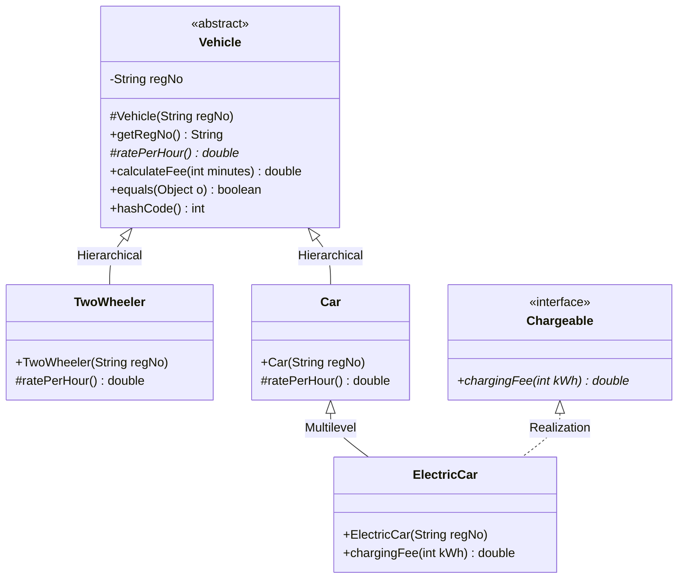

# Task 6: Inheritance Hierarchy and Constructor Execution Tracing

## 1. Inheritance Hierarchy Architecture

### 1.1 Structural Taxonomy
The vehicle domain model uses a hybrid inheritance model combining **Hierarchical Inheritance** and **Multilevel Inheritance**:
1. **Hierarchical Inheritance:**
   - Abstract Superclass: `Vehicle`
   - Direct Subclasses: `TwoWheeler` extends `Vehicle`, `Car` extends `Vehicle`
2. **Multilevel Inheritance:**
   - `ElectricCar` extends `Car`, which in turn extends `Vehicle`
   - `ElectricCar` also implements `Chargeable` (Interface Abstraction)

```
        +-------------------------+
        |         Vehicle         |
        |       (Abstract)        |
        +-------------------------+
                     ^
                     |
         +-----------+-----------+
         |                       |
+-----------------+     +-----------------+
|   TwoWheeler    |     |       Car       |
+-----------------+     +-----------------+
                                 ^
                                 |
                        +-----------------+
                        |   ElectricCar   |
                        +-----------------+
                                 :
                                 : implements
                        +-----------------+
                        |   Chargeable    |
                        |   (Interface)   |
                        +-----------------+
```

### 1.2 UML Class Diagram (Mermaid)



---

## 2. Inheritance Mechanics & Use of `super`

### 2.1 Constructor Delegation with `super(...)`
Subclass constructors cannot directly assign private superclass fields. `super(regNo)` must be the first statement in the subclass constructor to delegate initialization to the parent class:
```java
class Car extends Vehicle {
    Car(String regNo) {
        super(regNo); // Invokes Vehicle(String regNo)
    }
}
```

### 2.2 Method and Field Access via `super`
If a subclass overrides a method or shadows a field, `super.methodName()` allows explicit invocation of the superclass implementation.

---

## 3. Traced Constructor Execution Order for `ElectricCar`

When an `ElectricCar` instance is allocated:
```java
Vehicle ec = new ElectricCar("TN03EV9999");
```

### Execution Trace:
1. **JVM Allocation:** Allocates raw memory on Heap, zeroes all instance attributes.
2. **`java.lang.Object` Constructor:** Root constructor runs first.
3. **`Vehicle(String regNo)` Constructor:**
   - Assigns `this.regNo = "TN03EV9999"`.
   - Executes instance variable initializers of `Vehicle`.
4. **`Car(String regNo)` Constructor:**
   - Receives control following `super(regNo)`.
   - Executes instance variable initializers of `Car`.
5. **`ElectricCar(String regNo)` Constructor:**
   - Completes subclass-specific initialization and returns reference.

**Execution Order:** `Object` $\rightarrow$ `Vehicle` $\rightarrow$ `Car` $\rightarrow$ `ElectricCar`.

---

## 4. Alternative Concept and Complexity Analysis

### Inheritance (`is-a`) vs. Composition (`has-a`)

| Dimension | Inheritance (`Car is-a Vehicle`) | Composition (`Vehicle has-a VehicleType`) |
| :--- | :--- | :--- |
| **Coupling** | High: Subclasses depend on superclass implementation. | Low: `Vehicle` delegates fee computation to a decoupled strategy/type object. |
| **Adding New Vehicle Type** | Requires writing a new subclass (e.g., `class Truck extends Vehicle`). | Requires creating a new `VehicleType` configuration instance (e.g., `new VehicleType("Truck", 40.0)`). |
| **Fee Calculation Time** | **$O(1)$** via Virtual Method Table (vtable) dispatch. | **$O(1)$** via pointer dereference (`type.getRate()`). |
| **Space Complexity** | **Minimal:** 1 object header + fields per vehicle. | **Slightly higher:** Extra reference pointer to `VehicleType` instance. |
| **Dynamic Switching** | Cannot change vehicle type at runtime. | Can switch strategy dynamically at runtime. |
